# Schema Database EdTeknoGuard (Ternormalisasi Penuh Sesuai antislop-vibecoding-database)

Dokumentasi arsitektur basis data relasional, kamus data (*data dictionary*), indeks optimasi, dan relasi eksplisit antar-entitas untuk sistem **EdTeknoGuard**.

---

## 1. Entity Relationship Diagram (ERD)

```mermaid
erDiagram
    KANTORS ||--o{ PELANGGAN : "mengelola (1 to N)"
    KANTORS ||--o{ TIKET_KENDALA : "wilayah tiket (1 to N)"
    KANTORS ||--o{ SYSTEM_SETTINGS : "pengaturan kantor (1 to N CASCADE)"
    KANTORS ||--o{ MODEM_CREDENTIALS : "kredensial fallback (1 to N CASCADE)"
    KANTORS ||--o{ USER_KANTORS : "kantor ditugaskan (1 to N CASCADE)"
    USERS ||--o{ USER_KANTORS : "memiliki penugasan (1 to N CASCADE)"
    USERS ||--o{ USER_ACTIVITY_LOGS : "mencatat aktivitas (1 to N SET NULL)"
    USERS ||--o{ USER_NOTIFICATION_READS : "status baca (1 to N CASCADE)"
    PAKETS ||--o{ PELANGGAN : "berlangganan (1 to N)"

    PELANGGAN ||--|| PERANGKAT_ONT : "memiliki modem (1 to 1 CASCADE)"
    PELANGGAN ||--o{ LOG_PERFORMA_ONT : "memiliki riwayat (1 to N CASCADE)"
    PELANGGAN ||--o{ ALERT_LOGS : "menerima alert (1 to N CASCADE)"
    PELANGGAN ||--o{ TIKET_KENDALA : "membuat tiket (1 to N CASCADE)"
    PELANGGAN ||--o{ KUOTA_PELANGGAN : "memiliki pemakaian (1 to N CASCADE)"
    
    KANTORS {
        int id_kantor PK "Primary Key Terstruktur"
        varchar nama UK "Nama Kantor Operasional (e.g. Kantor Pusat, Banyumas, Cabang)"
        boolean is_active "Status Operasional Aktif/Nonaktif"
        text alamat
        varchar mikrotik_host
        int mikrotik_port
        varchar mikrotik_user
        varchar mikrotik_pass
        int mikrotik_sync_interval
        datetime last_mikrotik_sync
        datetime created_at
    }

    USERS {
        int id PK "Primary Key Pengguna Berurutan (1, 2, 3, ...)"
        varchar username UK "Username Login Admin/Teknisi"
        varchar hashed_password "Bcrypt Hash"
        varchar nama_karyawan "Nama Lengkap Petugas"
        varchar no_wa "Nomor WhatsApp Petugas"
        varchar role "super admin, admin, teknisi"
        varchar allowed_kantor "JSON Array Wilayah Kantor (Backup)"
        boolean is_active "Status Akun Aktif"
        datetime created_at
        datetime updated_at
    }

    USER_KANTORS {
        int id_user_kantor PK "Primary Key"
        int user_id FK "Relasi ke users.id (CASCADE)"
        int id_kantor FK "Relasi ke kantors.id_kantor (CASCADE)"
        varchar kantor_kode "Kode teks (Backward-compatibility)"
        datetime created_at
    }

    MODEM_CREDENTIALS {
        int id_credential PK "Primary Key"
        int id_kantor FK "Relasi ke kantors.id_kantor (CASCADE)"
        varchar kantor_kode "Kode teks (Backward-compatibility)"
        varchar username "Username Login ONT"
        varchar password "Password Login ONT"
        int urutan "Prioritas Uji Fallback (1, 2, 3...)"
        datetime created_at
        datetime updated_at
    }

    PAKETS {
        int id_paket PK "Primary Key"
        varchar nama UK "Nama Paket Layanan (e.g. 20 Mbps)"
        int kecepatan_mbps "Bandwidth Download/Upload (Mbps)"
        numeric harga "Biaya Bulanan"
        varchar deskripsi
        datetime created_at
    }

    PELANGGAN {
        varchar id_pelanggan PK "Natural Primary Key Pelanggan (e.g. CUST-001)"
        varchar nama "Nama Lengkap Warga / Pelanggan"
        text alamat
        varchar no_hp "No WA / Kontak Pelanggan"
        varchar pop "Point of Presence / Server Area"
        int id_kantor FK "Relasi ke kantors.id_kantor"
        varchar kantor "Wilayah Kantor Teks (Backward-compatibility)"
        varchar paket FK "Paket Layanan (Relasi pakets.nama)"
        boolean is_monitored "Status Pemantauan Berkala"
        boolean is_active "Status Layanan Aktif"
        varchar password_hash "Kata Sandi Portal Warga"
        varchar lokasi_gps "Koordinat Maps"
        varchar status_verifikasi "TERVERIFIKASI, PENDING, DITOLAK"
        datetime last_login
        varchar status_lease
        varchar status_isolir
        varchar queue_name
        datetime created_at
        datetime updated_at
    }

    PERANGKAT_ONT {
        bigint id_perangkat PK "Primary Key"
        varchar id_pelanggan FK "Relasi ke pelanggan.id_pelanggan (1-to-1 CASCADE)"
        varchar ip_router "IP Manajemen Modem ONT (Unik)"
        varchar ip_ont "IP ONT Fisik"
        varchar jenis_modem "Tipe ONT (GM220-S, XPON, etc.)"
        varchar mac_address
        numeric redaman_baseline "Redaman Awal dBm"
        varchar nama_wifi "SSID WiFi Pelanggan"
        varchar password_wifi "Kata Sandi WiFi"
        varchar user_admin "Username Login Web GUI ONT Valid"
        varchar pass_admin "Password Login Web GUI ONT Valid"
        varchar status_kredensial "VALID, INVALID, UNTESTED"
        text failed_credentials "JSON Array Kredensial Gagal"
        varchar snmp_community
        int los_count
        datetime created_at
        datetime updated_at
    }

    LOG_PERFORMA_ONT {
        bigint id_log PK "Primary Key"
        varchar id_pelanggan FK "Relasi ke pelanggan.id_pelanggan (CASCADE)"
        datetime waktu_cek "Timestamp Pemeriksaan"
        numeric rx_power "Daya Terima Optik (dBm)"
        numeric suhu_ont "Suhu Perangkat (Celcius)"
        bigint uptime "Detik Aktif Perangkat"
        varchar status_koneksi "NORMAL, WARNING, CRITICAL, LOS"
        int latency_ms "Latensi Jaringan (ms)"
        varchar keterangan
    }

    ALERT_LOGS {
        bigint id_alert PK "Primary Key"
        varchar id_pelanggan FK "Relasi ke pelanggan.id_pelanggan (CASCADE)"
        varchar tipe_alert "REDAMAN_DROP, ONT_LOS, OVERHEAT"
        numeric rx_power "Nilai Redaman saat Terjadi Alert"
        text pesan "Konten Notifikasi"
        text target_recipients "ID Tujuan Telegram"
        varchar status_kirim "SUCCESS, FAILED"
        datetime waktu_kirim "Waktu Pengiriman Pesan"
    }

    TIKET_KENDALA {
        varchar id_tiket PK "Natural Primary Key Tiket (e.g. TKT-2026-001)"
        varchar id_pelanggan FK "Relasi ke pelanggan.id_pelanggan (CASCADE)"
        int id_kantor FK "Relasi ke kantors.id_kantor"
        varchar kantor "Wilayah Kantor Teks (Backward-compatibility)"
        varchar kategori "Jenis Kendala"
        text deskripsi "Detail Keluhan"
        varchar no_wa_pelapor "No WA Kontak Pelapor"
        numeric redaman_saat_lapor "Redaman Terakhir (dBm)"
        varchar status_ont_saat_lapor "Status ONT saat Lapor"
        varchar status "MENUNGGU, DICEK_ADMIN, DIPROSES, SELESAI"
        text catatan_teknisi "Tindakan Penyelesaian"
        datetime created_at
        datetime updated_at
    }

    KUOTA_PELANGGAN {
        bigint id_kuota PK "Primary Key"
        varchar id_pelanggan FK "Relasi ke pelanggan.id_pelanggan (CASCADE)"
        varchar periode_bulan "Format YYYY-MM"
        numeric kuota_terpakai_gb "Akumulasi Kuota (GB)"
        varchar kecepatan_paket
        bigint upload_bytes
        bigint download_bytes
        datetime last_sync_mikrotik
        datetime created_at
        datetime updated_at
    }

    USER_ACTIVITY_LOGS {
        bigint id_activity PK "Primary Key"
        int user_id FK "Relasi ke users.id (ON DELETE SET NULL)"
        varchar username "Username Pelaku Aksi"
        varchar nama_karyawan "Nama Petugas"
        varchar role "Role Pengguna"
        varchar action "LOGIN, LOGOUT, SCAN, EDIT_USER, etc."
        varchar ip_address "IP Asal Request"
        text user_agent "Browser/Client Info"
        varchar status "SUCCESS, FAILED"
        text keterangan "Detail Audit Log"
        datetime created_at
    }

    USER_NOTIFICATION_READS {
        bigint id_read PK "Primary Key"
        int user_id FK "Relasi ke users.id (CASCADE)"
        varchar notification_type "Tipe Notifikasi (e.g. TIKET)"
        varchar reference_id "ID Referensi Entitas"
        datetime read_at
    }

    SYSTEM_SETTINGS {
        int id_setting PK "Primary Key"
        int id_kantor FK "Relasi ke kantors.id_kantor (CASCADE) / NULL untuk global"
        varchar kantor_kode "Kode Wilayah Teks (Backward-compatibility)"
        varchar key_name "Nama Kunci Pengaturan (Composite UK)"
        text value_text "Nilai Parameter"
        datetime updated_at
    }
```

---

## 2. Standar Desain Database (Penerapan antislop-vibecoding-database)

1. **DB-01: Jenis Database Tepat (Relational MySQL InnoDB)**
   - Semua tabel menggunakan engine InnoDB dengan ACID transaction support.
2. **DB-02: Relasi Eksplisit & Integritas Referensial**
   - Menggunakan Foreign Key eksplisit (`ON DELETE CASCADE` untuk data anakan pelanggan dan relasi penugasan user/kantor).
   - Menghilangkan penyimpanan data relasional dalam bentuk string JSON Array tanpa tabel relasi:
     - Kredensial modem diekstrak ke tabel relasi `modem_credentials` (`id_kantor` $\rightarrow$ `kantors.id_kantor`).
     - Penugasan wilayah user dinormalisasi ke tabel pivot `user_kantors` (`user_id` $\rightarrow$ `users.id`, `id_kantor` $\rightarrow$ `kantors.id_kantor`).
3. **DB-03: Dokumentasi Skema & ERD Terpusat**
   - Didokumentasikan secara lengkap pada berkas ini (`db/schema.md`) dengan diagram Mermaid ERD dan penjelasan setiap kolom.
4. **DB-04: Penamaan Entitas & Kolom Jelas**
   - Penamaan tabel dan kolom konsisten menggunakan Bahasa Indonesia yang deskriptif (`pelanggan`, `perangkat_ont`, `log_performa_ont`, `tiket_kendala`, `kuota_pelanggan`).
   - Penamaan Primary Key deskriptif: bukan `id` ambigu, melainkan `id_<entitas>` (`id_kantor`, `id_pelanggan`, `id_tiket`, `id_perangkat`, `id_log`, `id_alert`, `id_kuota`, `id_activity`, `id_read`, `id_user_kantor`, `id_credential`, `id_setting`).
5. **DB-05: Struktur ID Jelas & Tanpa Angka Acak/Lompat**
   - Natural Primary Key diterapkan pada entitas bisnis: `pelanggan.id_pelanggan` dan `tiket_kendala.id_tiket`. Kolom integer surrogate yang redundan telah dieliminasi.
   - Tabel master pengguna (`users`) menggunakan ID terurut rapi (1, 2, 3, 4, ...) tanpa nilai acak/loncat ribuan.
   - Kolom string `kode` pada tabel `kantors` telah dihapus; entitas kantor diidentifikasi melalui `id_kantor` sebagai PK dan `nama` sebagai nama unik. Seluruh Foreign Key anak terhubung langsung ke `id_kantor`.
6. **DB-06: Indeks & Optimasi Kueri**
   - Indeks komposit terpasang pada kolom filter utama seperti (`id_pelanggan`, `waktu_cek`) pada `log_performa_ont` dan (`id_pelanggan`, `waktu_kirim`) pada `alert_logs`.
